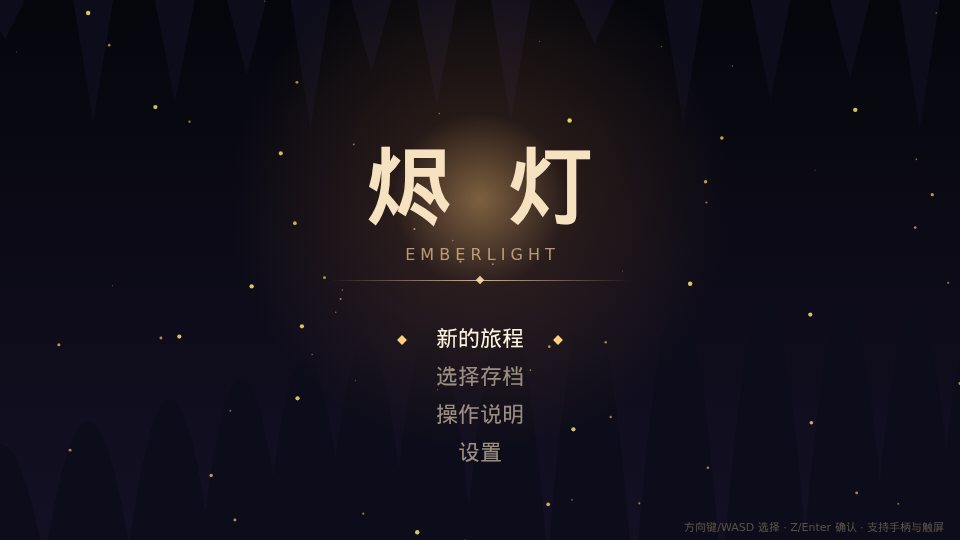
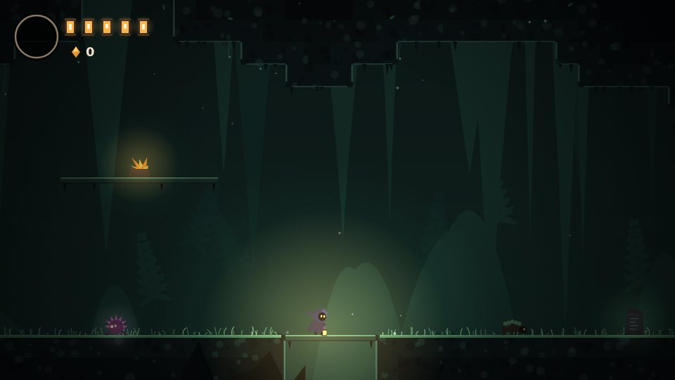
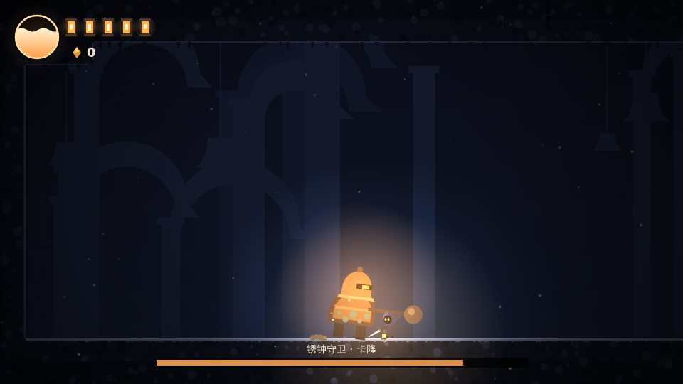
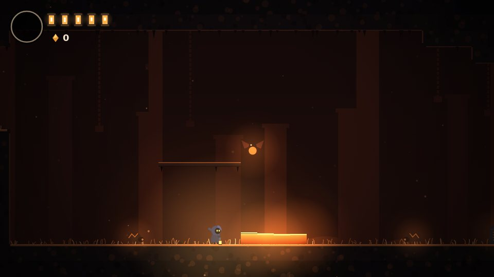
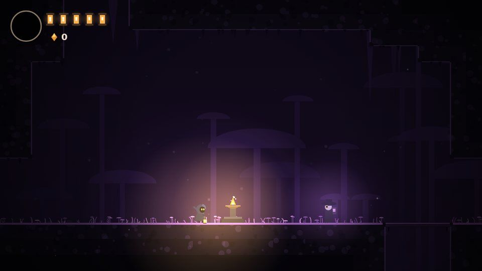
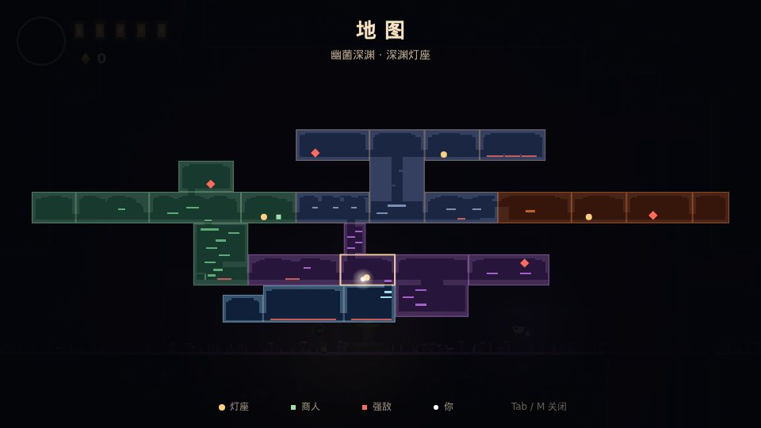

# 烬灯 · Emberlight

一款原创的 2D 类银河恶魔城（Metroidvania）动作冒险游戏。你是一名提灯者，带着最后一点余烬深入地下，去找那只吞噬了所有光明的巨蛾。

**[▶ 在线试玩](https://whathappenedchuanwei.github.io/emberlight/)**　·　[作者博客](https://whathappenedchuanwei.github.io/)　·　[反馈问题](https://github.com/WhatHappenedChuanWei/emberlight/issues)

纯 HTML5 Canvas + 原生 JavaScript，**零依赖、零外部素材**：画面、音效和音乐全部由代码实时生成。不需要安装、构建或联网，打开网页就能玩。

<p>
  
  
</p>
<p>
  
  
</p>
<p>
  
  
</p>

> **状态：早期版本（v0.1）。** 流程完整，可以从头打到结局；但画面均为程序绘制，手感与难度仍在调整，欢迎反馈。

## 特色

- **5 个区域，24 个房间**：苔径、沉钟回廊、幽菌深渊、灰烬熔窑、霜息穹顶，外加隐藏秘室、单向捷径和荆棘试炼
- **4 种能力**，用来解锁新区域：影步（冲刺）、钩爪（蹬墙）、蛾翼（二段跳）、烬火弹（远程法术，可击碎灵焰封印）
- **4 个 Boss**：锈钟守卫 · 卡隆、熔炉看守 · 伊格（可选）、苔母 · 薇丝（可选，藏在苔光长廊天花板之上）、噬光之母 · 维萨（最终）
- **8 种敌人、9 种灯饰**：灯饰装在有限的槽位里，搭配出不同打法
- **地形机制**：单向平台、尖刺 / 熔岩、可破坏墙、灵焰封印、拉杆铁栅、碎冰平台、移动平台
- **探索与存档**：灯座存档、灯语传送、死亡后留下「遗珀」可回去取回、自动地图、收集率统计
- **终局内容**：钟声试炼（连战四位强敌）、三档难度、隐藏结局、怪物图鉴「灯下札记」
- 支持**键盘、手柄、触屏**；3 个存档位

## 操作

| 动作 | 键盘 | 手柄 |
|---|---|---|
| 移动 | ← → / A D | 左摇杆 / 十字键 |
| 跳跃（按住跳更高） | Z / K / 空格 | A |
| 挥刀（可配合 ↑ / ↓） | X / J | X |
| 冲刺（需习得） | C / L / Shift | RB / RT |
| 聚焦回血（地面长按） | V / I | B |
| 烬火弹（需习得） | F / U | Y |
| 交互（灯座 / NPC / 石碑 / 商人） | ↑ / W | ↑ |
| 下穿单向平台 | ↓ + 跳跃 | ↓ + A |
| 地图 | Tab / M | Back / LB |
| 暂停 | Esc / P | Start |

空中向下挥刀，击中敌人或尖刺会弹起。击中敌人会积攒灵焰（左上角的球），满一格后可长按聚焦回血。触屏设备上会自动显示虚拟按键。

## 本地运行

不需要任何构建，直接用浏览器打开 `index.html` 即可（推荐 Chrome / Edge）。

进度保存在浏览器的本地存储里，在灯座休息、拾取道具、击败强敌时写入。换设备或清理浏览器数据后存档会消失。浏览器要求先有一次用户操作才能播放声音，所以进游戏后按任意键即可。

## 开发

### 项目结构

```
index.html          入口
js/core.js          常量、工具、输入（键盘 + 手柄）、粒子、瓦片物理、相机
js/audio.js         WebAudio 合成音效 + 生成式氛围音乐
js/world.js         区域与房间数据（ASCII 地图，按全局坐标拼接）
js/render.js        程序化地形 / 视差背景 / 光照
js/player.js        玩家
js/enemies.js       敌人、投射物、琥珀、烬火弹
js/objects.js       灯座、NPC、商人、石碑、拾取物、遗珀；对话与能力文本
js/boss.js          四个 Boss
js/ui.js            HUD、菜单、地图、对话、商店、结局
js/game.js          游戏流程：房间切换、战斗判定、存档、死亡等
js/main.js          画布缩放与固定步长主循环
js/touch.js         触屏虚拟按键（仅触屏设备显示）
tools/validate.js   关卡校验（行宽、重叠、出入口对齐）
tools/test.js       回归测试（无头浏览器中逐帧模拟，约 80 项）
```

### 关卡编辑

房间写在 `js/world.js` 中，每个房间有全局瓦片坐标 `x, y`。玩家走出房间边缘时，会自动进入该全局位置上的房间，因此不需要手写出口。改完后运行 `node tools/validate.js`，确认相邻房间的开口对齐。

图例：`#` 实心　`.` 空　`^` 尖刺　`~` 熔岩　`=` 单向平台　`X` 可破坏墙　`O` 灵焰封印　`D` Boss 闸门　`B` 灯座　`N` NPC　`S` 商人　`T` 石碑　`H` 心核　`A` 能力　`$` 琥珀矿　`K` Boss　`P` 出生点　`C` 灯饰　`L` 拉杆　`G` 铁栅　`-` 碎冰平台　`M` 移动平台　`U` 灯饰槽　`Q` 菌光孢子　敌人：`c f h s g e b k`

### 测试

`tools/` 下的脚本需要 Node.js 和 `playwright-core`（自行安装，或指向已有的）。通过环境变量指定路径：

```bash
node tools/validate.js
PW_CORE=/path/to/node_modules/playwright-core PW_EXE=/path/to/chrome-headless-shell node tools/test.js
```

游戏本身不依赖这些，只是开发时用来校验关卡和回归测试。

## 路线图

目前的版本更像一个"系统齐全的原型"，接下来想做的方向（不保证时间）：

- 手绘风格美术与逐帧动画，替换现在的程序化图形
- 更大、更复杂的关卡：更多高低落差、环形回路和捷径
- 更丰富的战斗：更多敌人与 Boss 招式、阶段演出
- 正式作曲的配乐和更细致的音效
- NPC 故事线与环境叙事

## 反馈

玩到哪里卡住了、哪里太难或太简单、发现了 bug，都欢迎到 [Issues](https://github.com/WhatHappenedChuanWei/emberlight/issues) 告诉我。写清楚在哪个房间、做了什么操作，会很有帮助。

## 许可证

[MIT](LICENSE) © 2026 Chuanwei

## 致谢

本项目由作者与 Claude（Anthropic）协作开发。游戏中所有代码、图形、音效和音乐均为原创并由代码生成，没有使用第三方素材。
